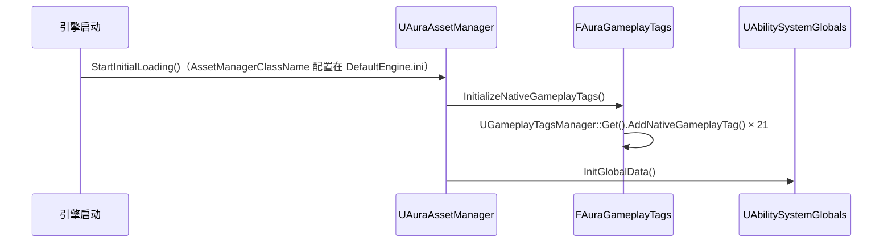

# 01 · GAS 核心与属性系统

涉及的类（按初始化顺序）：

| 类 | 文件 | 职责 |
|---|---|---|
| `UAuraAssetManager` | `Source/Aura/Public/AuraAssetManager.h` | 项目级单例资源管理器，启动早期初始化原生 GameplayTags 与 GAS 全局数据 |
| `FAuraGameplayTags` | `Source/Aura/Public/AuraGameplayTags.h` | 原生 GameplayTags 单例，C++ 代码可编译期访问的标签集合 |
| `UAuraAbilitySystemComponent` | `.../AbilitySystem/AuraAbilitySystemComponent.h` | 自定义 ASC：能力授予、输入标签路由、效果应用消息 RPC |
| `UAuraAttributeSet` | `.../AbilitySystem/AuraAttributeSet.h` | 17 个属性 + 复制 + Clamp + 效果上下文提取 |
| `UMMC_MaxHealth` / `UMMC_MaxMana` | `.../ModMagCalc/` | 属性捕获式计算器，动态算出最大生命/法力 |
| `UAttributeInfo` | `.../Data/AttributeInfo.h` | 属性说明数据资产（Tag→名称/描述），供属性菜单 UI |

---

## 1. 启动初始化（调用顺序）



### UAuraAssetManager::StartInitialLoading() — `AuraAssetManager.cpp:14`

- `FAuraGameplayTags::InitializeNativeGameplayTags()`：注册 4 个 Primary + 10 个 Secondary + 6 个 InputTag 共 20 个原生标签（`Attributes.*`、`InputTag.*` 两族）。
- `UAbilitySystemGlobals::Get().InitGlobalData()`：初始化 GAS 全局数据，**其中包含 TargetData 脚本结构缓存（InitTargetDataScriptStructCache）—— 使用 FGameplayAbilityTargetData 网络复制的必要前提**。

**为什么是最佳实现：**
- `AddNativeGameplayTag` 在引擎最早期注册标签，保证任何代码/蓝图引用时标签必然存在；用 C++ 成员变量持有（`Tags.Attributes_Primary_Strength`）而不是散落的 `FGameplayTag::RequestGameplayTag("Attributes.Primary.Strength")` 字符串——拼写错误变成**编译期错误**而非运行时无效标签。
- 单例（`static FAuraGameplayTags GameplayTags` + `Get()`）保证全项目只有一份标签实例，零拷贝零查找开销。
- 管理器通过 `DefaultEngine.ini` 的 `AssetManagerClassName=/Script/Aura.AuraAssetManager` 注册，引擎用工厂反射创建，无需手动实例化。

---

## 2. UAuraAbilitySystemComponent（自定义 ASC）

### 方法功能与调用关系

| 方法 | 调用方 | 功能 |
|---|---|---|
| `AbilityActorInfoSet()` | 角色的 `InitAbilityActorInfo()` | 绑定 `OnGameplayEffectAppliedDelegateToSelf` → `ClientEffectApplied`（多播委托） |
| `AddCharacterAbilities(StartupAbilities)` | 角色基类 `AddCharacterAbilities()`（仅服务器） | 为每个能力类构造 `FGameplayAbilitySpec(Class, 1)`，写入动态标签后 `GiveAbility` |
| `AbilityInputTagHeld(InputTag)` | PlayerController 的输入回调 | 按 DynamicAbilityTags 精确匹配 → `AbilitySpecInputPressed` + 未激活则 `TryActivateAbility` |
| `AbilityInputTagReleased(InputTag)` | PlayerController 的输入回调 | 匹配后 `AbilitySpecInputReleased`（只标记按键松开，不取消能力） |
| `ClientEffectApplied_Implementation(...)` | 服务器侧 `OnGameplayEffectAppliedDelegateToSelf` 触发（Client Reliable RPC） | `EffectSpec.GetAllAssetTags` 取出 GE 资产标签 → `EffectAssetTags.Broadcast` |

### 关键细节（`AuraAbilitySystemComponent.cpp`）

```cpp
// 授予能力时把"输入标签"写进能力 Spec 的动态标签容器
AbilitySpec.DynamicAbilityTags.AddTag(AuraAbility->StartupInputTag);
```

- `AddCharacterAbilities` 对每个能力 Cast 成 `UAuraGameplayAbility` 读 `StartupInputTag` —— **标签放在能力 CDO 上由蓝图配置，Spec 上的 DynamicAbilityTags 是运行时副本**，因此可以不改蓝图就换按键绑定。
- `AbilityInputTagHeld` 里**先** `AbilitySpecInputPressed` **再** `TryActivateAbility`：保证能力激活时 `InputPressed` 逻辑已执行（例如"首次按下即释放"类技能），注释中说明了激活与输入按下的顺序问题。

### ClientEffectApplied 为什么设计成 Client RPC？（`AuraAbilitySystemComponent.h:27`）

`OnGameplayEffectAppliedDelegateToSelf` **只在服务器端触发**。而"拾取药水弹出提示"是所有端都要看到的 UI 表现。方案：服务器端绑定该委托 → 委托触发时执行 `ClientEffectApplied`（Client RPC）→ 各客户端本地广播 `EffectAssetTags` 给 UI。这是项目里修过的一个真实 bug（commit `37c4199`：之前只有服务器弹提示）。

**为什么是最佳实现：** GE 的应用是服务器权威事件，RPC 把"哪个效果的哪些标签被应用"这个事实推送给客户端，UI 只消费标签查表显示文案，不复制 GE 本身的数值数据——带宽最小、职责清晰。

---

## 3. UAuraAttributeSet（17 个属性）

### 属性清单与分类

- Primary（4）：Strength / Intelligence / Resilience / Vigor
- Secondary（10）：Armor / ArmorPenetration / BlockChance / CriticalHitChance / CriticalHitDamage / CriticalHitResistance / HealthRegeneration / ManaRegeneration / MaxHealth / MaxMana
- Vital（2）：Health / Mana

全部 `UPROPERTY(BlueprintReadOnly, ReplicatedUsing = OnRep_*)`，`GetLifetimeReplicatedProps` 中 `DOREPLIFETIME_CONDITION_NOTIFY`，`OnRep_*` 统一用 `GAMEPLAYATTRIBUTE_REPNOTIFY` 宏。

### ATTRIBUTE_ACCESSORS 宏（`AuraAttributeSet.h:50`）

```cpp
#define ATTRIBUTE_ACCESSORS(ClassName, PropertyName) \
    GAMEPLAYATTRIBUTE_PROPERTY_GETTER(ClassName, PropertyName) \
    GAMEPLAYATTRIBUTE_VALUE_GETTER(PropertyName) \
    GAMEPLAYATTRIBUTE_VALUE_SETTER(PropertyName) \
    GAMEPLAYATTRIBUTE_VALUE_INITTER(PropertyName)
```

一个属性一行代码生成 4 个函数（`GetXAttribute/GetX/SetX/InitX`）。**为什么最佳：** 17 个属性手写 getter/setter 会有上百行重复代码，宏是 Epic 官方 AttributeSet.h 自带的标准做法（`GAMEPLAYATTRIBUTE_PROPERTY_GETTER` 等），零额外抽象。

### TagsToAttributes —— Tag → Getter 函数指针 map（`AuraAttributeSet.h:69`）

```cpp
template<class T>
using TStaticFuncPtr = typename TBaseStaticDelegateInstance<T, FDefaultDelegateUserPolicy>::FFuncPtr;

TMap<FGameplayTag, TStaticFuncPtr<FGameplayAttribute()>> TagsToAttributes;
```

构造函数里逐个注册：

```cpp
TagsToAttributes.Add(GetGameplayTags.Attributes_Primary_Strength, GetStrengthAttribute);
// ... 共 14 条
```

`GetStrengthAttribute` 是宏生成的**静态函数**（签名 `FGameplayAttribute()`），成员函数指针需要对象、无法存入统一容器，静态函数指针才是正确的键值类型（见 commit `85ec66b` 的三种方案对比：委托 BindStatic → 静态函数指针模板别名）。

**为什么是最佳实现：** 属性菜单控制器遍历这个 map 就能批量广播所有属性（见文档 06），**新增属性 = AttributeSet 加属性 + 加一行 map 注册**，UI 层零改动。这是"数据驱动 + 反射式批量处理"的典型手法。

### 三大回调钩子

| 回调 | 触发时机 | 本项目的实现 |
|---|---|---|
| `PreAttributeChange` | 属性当前值（CurrentValue）被修改**前** | Clamp Health/Mana 到 [0, Max] |
| `PostGameplayEffectExecute` | 每个 GE 的每个 Modifier 执行**后** | `SetEffectProperties` 提取 Source/Target 上下文 |
| `PreAttributeBaseChange` | 基础值（BaseValue）修改前 | 同样 Clamp（防御性） |

**为什么 Clamp 放在 PreAttributeChange 而不是 Post：** Post 里改值会触发递归；Pre 里对 NewValue 做限制是唯一干净的做法。注释同时说明了**这里只做数值限制、不做网络复制**——因为该回调在预测执行时也会被调用，在这里同步网络状态会破坏 GAS 预测模型（这是官方文档明确警告的点）。

### SetEffectProperties（`AuraAttributeSet.cpp:194`）

从 `FGameplayEffectModCallbackData` 中提取两端上下文，填充 `FEffectProperties{EffectContextHandle, SourceASC/AvatarActor/Controller/Character, Target...}`：

1. `Data.EffectSpec.GetContext()` 拿 `FGameplayEffectContextHandle`；
2. `GetOriginalInstigatorAbilitySystemComponent()` 拿源 ASC（**原初发动者**，注意与 Instigator 的区别——隔山打牛场景下 OriginalInstigator 是真正出手的人）；
3. 从 `AbilityActorInfo->AvatarActor / PlayerController` 拿源角色/控制器，空控制器时用 `Pawn->GetController()` 兜底；
4. Target 侧直接取自 `Data.Target.AbilityActorInfo`。

**为什么最佳：** 伤害计算（后续讲）需要"谁打谁、双方属性"才能算护甲减免/暴击；把提取逻辑封装成独立函数，`PostGameplayEffectExecute` 保持只读清爽。

---

## 4. MMC —— 属性捕获式计算器

### UMMC_MaxHealth（`MMC_MaxHealth.cpp`）

构造函数注册捕获定义：

```cpp
VigorDef.AttributeToCapture = UAuraAttributeSet::GetVigorAttribute();
VigorDef.AttributeSource = EGameplayEffectAttributeCaptureSource::Target; // 捕获"目标"身上的 Vigor
VigorDef.bSnapshot = false;                                               // 求值时实时取值，不做快照
RelevantAttributesToCapture.Add(VigorDef);
```

求值函数：

```cpp
GetCapturedAttributeMagnitude(VigorDef, Spec, EvaluateParameters, Vigor);   // 拿到捕获的属性值
ICombatInterface* CI = Cast<ICombatInterface>(Spec.GetEffectContext().GetSourceObject());
const int32 PlayerLevel = CI->GetPlayerLevel();                            // 从源对象拿等级
return 80.f + 2.5f * Vigor + 10.f * PlayerLevel;
```

`UMMC_MaxMana` 同构：捕获 Intelligence，公式 `50 + 2.5×Int + 15×Level`。

**调用链路：** GE_VitalAttributes（蓝图，用 MMC 作为 MaxHealth/MaxMana 的 Modifier 计算方式）→ 应用到角色 → ASC 求值 Spec 时调 `CalculateBaseMagnitude_Implementation` → 捕获 Vigor/Intelligence → 通过 `ICombatInterface` 拿到等级（`ApplyEffectToSelf` 时 `ContextHandle.AddSourceObject(this)` 把角色塞进了 EffectContext，`GetSourceObject` 才能拿到）。

**为什么是最佳实现：**
- **派生属性用捕获而不是硬编码数值**：Vigor/等级变了，MaxHealth 自动跟着变（属性系统内的"反应式"计算），这是 GAS 官方推荐的 MMC 模式；
- **用接口拿等级而不是 Cast 具体类**：MMC 与角色类解耦，任何实现了 `ICombatInterface` 的角色都能用这个 MMC；
- `bSnapshot=false`：Duration 类 GE 每 Tick 重算时都能看到最新属性；Snapshot 只适合 Instant 一次性取值。

---

## 5. UAttributeInfo（数据资产）

`FAuraAttributeInfo{AttributeTag, AttributeName(FText), AttributeDescription(FText), AttributeValue}` 数组 + `FindAttributeInfoForTag(Tag, bLogNotFound)`（线性查找，未找到时打错误日志）。

**职责分工：** 数值来自 AttributeSet，**名称/描述/图标来自数据资产** —— 策划在编辑器里改文案不碰代码，属性菜单 UI 只做展示。`AttributeValue` 是运行时填充的展示字段（`AttributeMenuWidgetController` 在广播前写入），不是持久化数据。
