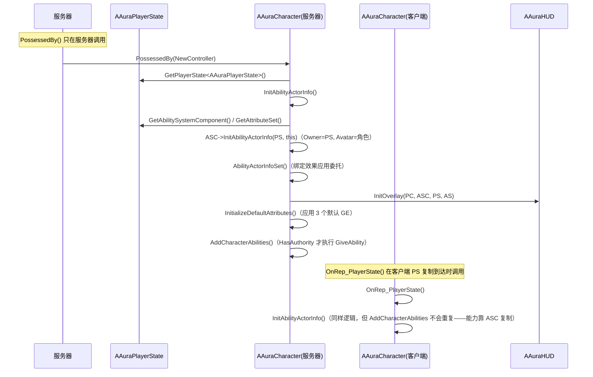

# 02 · 角色体系与初始化流程

涉及的类：

| 类 | 文件 | 职责 |
|---|---|---|
| `AAuraCharacterBase`（Abstract） | `Character/AuraCharacterBase.h` | 玩家与敌人公共基类：ASC/AS 指针、武器骨骼网格、默认属性 GE、能力授予 |
| `AAuraCharacter` | `Character/AuraCharacter.h` | 玩家角色：相机/SpringArm、PossessedBy + OnRep_PlayerState 双入口初始化 |
| `AAuraEnemy` | `Character/AuraEnemy.h` | 敌人：自建 ASC/AS、CustomDepth 高亮、血条 Widget、属性变化广播 |
| `AAuraPlayerState` | `Player/AuraPlayerState.h` | **ASC 与 AttributeSet 的真正归属者**、等级复制 |
| `IEnemyInterface` | `Interaction/EnemyInterface.h` | 高亮/取消高亮接口（控制器对敌人解耦） |
| `ICombatInterface` | `Interaction/CombatInterface.h` | 等级、战斗 socket 位置、面向目标（能力对角色解耦） |

---

## 1. 为什么 ASC 放在 PlayerState？（关键架构决策）

`AAuraPlayerState` 构造（`AuraPlayerState.cpp:10`）：

```cpp
AbilitySystemComponent = CreateDefaultSubobject<UAuraAbilitySystemComponent>("AbilitySystemComponent");
AbilitySystemComponent->SetIsReplicated(true);
AbilitySystemComponent->SetReplicationMode(EGameplayEffectReplicationMode::Mixed);
AttributeSet = CreateDefaultSubobject<UAuraAttributeSet>("AttributeSet");
NetUpdateFrequency = 100.0f;
```

**为什么是最佳实现（Epic GAS 官方文档推荐）：**
- **跨关卡持久**：PlayerState 与 PlayerController 一起在关卡切换时存活，Pawn 会销毁重生。ASC 放 Pawn 上，玩家死亡/换关卡时所有 GE（Buff、冷却）全部丢失；
- **重生安全**：重生只换 Pawn，属性系统不受影响；
- **网络同步保证**：PlayerState 天然随连接建立而同步，客户端可以很早拿到 ASC，无竞态。

对比：敌人（AI 控制的 Pawn，不跨关卡）ASC 直接放在 `AAuraEnemy` 自己身上，复制模式用 `Minimal`（AI 不需要把 GE 完整复制给客户端——客户端只要属性数值用于表现；玩家用 `Mixed` 是因为玩家需要看到自己身上的 GE 用于技能 UI/冷却等）。

---

## 2. 玩家初始化时序（双入口）



**为什么需要两个入口：**
- `PossessedBy` **只在服务器**被调用；
- 客户端的 PlayerState 是异步复制过来的，`OnRep_PlayerState` 是客户端"PlayerState 已就绪"的信号；
- 两个入口都调 `InitAbilityActorInfo`，各自端各初始化一次，**能力授予放在 `AddCharacterAbilities` 且用 `HasAuthority()` 保护**（`AuraCharacterBase.cpp:79`），避免客户端也 GiveAbility 造成双份。

**为什么不在 BeginPlay 里做：** BeginPlay 时 `GetPlayerState()` 可能仍为 nullptr（客户端尤其），此时拿不到 ASC。

### InitAbilityActorInfo 里的关键调用（`AuraCharacter.cpp:42`）

```cpp
AbilitySystemComponent->InitAbilityActorInfo(AuraPlayerState, this);
```

- 第一个参数 **OwnerActor**：逻辑拥有者（网络相关性/等级），用 PlayerState；
- 第二个参数 **AvatarActor**：物理代表（动画、骨骼、伤害受力体），用 Character；
- 之后 `AbilityActorInfoSet()` 绑定效果委托、HUD `InitOverlay` 建立 UI 数据线、`InitializeDefaultAttributes()` 应用初始属性。

---

## 3. 默认属性初始化（GE 链）

`InitializeDefaultAttributes()` → `ApplyEffectToSelf(DefaultPrimaryAttributes, 1.f)` ×3（Primary / Secondary / Vital，全按等级 1）：

```cpp
FGameplayEffectContextHandle ContextHandle = GetASC()->MakeEffectContext();
ContextHandle.AddSourceObject(this);          // ← MMC 从这里拿到"源对象"取等级
const FGameplayEffectSpecHandle SpecHandle = GetASC()->MakeOutgoingSpec(GE, Level, ContextHandle);
GetASC()->ApplyGameplayEffectSpecToTarget(*SpecHandle.Data.Get(), GetASC());
```

**为什么是三个 GE 而不是一个：** Primary/Secondary/Vital 属性对成长、Buff、死亡复活的重算时机不同（例如死亡清 Buff 不清基础属性），拆开才能独立控制。**为什么用 `AddSourceObject(this)`：** MMC（文档 01）通过 `Spec.GetEffectContext().GetSourceObject()` 拿到角色再取等级——EffectContext 是 Spec 数据在网络上传播的"信使"。

蓝图侧：`GE_PrimaryAttributes` / `GE_SecondaryAttributes` / `GE_VitalAttributes`（MaxHealth/MaxMana 的 Modifier 使用 `UMMC_MaxHealth` / `UMMC_MaxMana`）。

---

## 4. 敌人（AAuraEnemy）

### 构造与初始化

- 构造（`AuraEnemy.cpp:12`）：ASC（`SetIsReplicated(true)` + `Minimal`）、AttributeSet、`HealthBar`（UWidgetComponent 挂在根组件）；
- `BeginPlay`：`InitAbilityActorInfo()`（`InitAbilityActorInfo(this, this)` —— Owner 与 Avatar 都是自己）→ `InitializeDefaultAttributes()`；
- 血条：`Cast<UAuraUserWidget>(HealthBar->GetUserWidgetObject())` → `SetWidgetController(this)` —— **敌人自己充当血条 Widget 的控制器**，Widget 直接订阅敌人的 `OnHealthChanged / OnMaxHealthChanged`（BlueprintAssignable）；
- 属性广播（`AuraEnemy.cpp:59`）：`ASC->GetGameplayAttributeValueChangeDelegate(GetHealthAttribute()).AddLambda(...)` 转发到 `OnHealthChanged.Broadcast(Data.NewValue)`，并在 BeginPlay 末广播一次初始值。

### 高亮（Custom Depth 描边）

```cpp
void HighlightActor()   { GetMesh()->SetRenderCustomDepth(true);  SetCustomDepthStencilValue(CUSTOM_DEPTH_RED); /* Weapon 同样 */ }
void UnHighlightActor() { GetMesh()->SetRenderCustomDepth(false); /* Weapon 同样 */ }
```

`CUSTOM_DEPTH_RED = 250`（`Aura.h:7`）。**为什么最佳：** Custom Depth/Stencil 是后处理描边（`r.CustomDepth=3` 已在 DefaultEngine.ini 开启）的标准做法，纯渲染通道，不影响游戏逻辑碰撞。

### 已知问题（供自查）

`AuraEnemy.cpp:71-72` 初始广播疑似笔误——两次都广播了 `OnMaxHealthChanged`，第一次参数还是 `GetHealth()`：

```cpp
OnMaxHealthChanged.Broadcast(AuraAS->GetHealth());     // ← 应为 OnHealthChanged.Broadcast(GetHealth())
OnMaxHealthChanged.Broadcast(AuraAS->GetMaxHealth());  // 这行正确
```

导致 `OnHealthChanged` 没有初始广播（WBP_EnemyHealthBar 若依赖初始值会少一次刷新）。

---

## 5. 两个接口的用途

| 接口 | 方法 | 实现者 | 调用方 |
|---|---|---|---|
| `IEnemyInterface` | `HighlightActor` / `UnHighlightActor`（纯虚） | `AAuraEnemy` | `AAuraPlayerController::CursorTrace` —— 控制器不 Cast 具体敌人类型，任何 Actor 实现了接口就能高亮 |
| `ICombatInterface` | `GetPlayerLevel` / `GetCombatSocketLocation`（C++ 实现）、`UpdateFacingTarget`（BlueprintImplementableEvent，蓝图实现 MotionWarping 转向） | `AAuraCharacterBase`（默认实现） | MMC（等级）、`UAuraProjectileSpell`（发射点）、蓝图（转向） |

`CursorTrace` 用 `TScriptInterface<IEnemyInterface>`（UObject 安全的接口包装）+ `Implements<UEnemyInterface>()` 检测——UE 接口标准用法，比 Cast 到具体类更通用。
