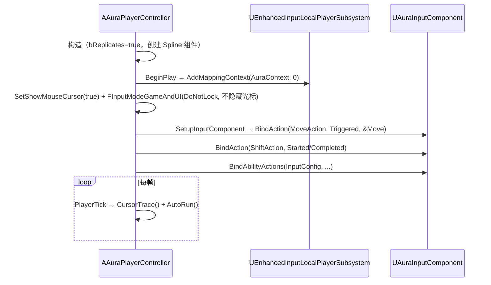

# 03 · 输入系统与移动控制

涉及的类：

| 类 | 文件 | 职责 |
|---|---|---|
| `FAuraInputAction`（结构体） | `Input/AuraInputConfig.h` | 一条"InputAction ↔ GameplayTag"映射 |
| `UAuraInputConfig`（UDataAsset） | `Input/AuraInputConfig.h` | 所有技能输入映射的配置资产（蓝图 DA_InputConfig 配置） |
| `UAuraInputComponent` | `Input/AuraInputComponent.h` | 继承 UEnhancedInputComponent，模板批量绑定 |
| `AAuraPlayerController` | `Player/AuraPlayerController.h` | Enhanced Input 挂载、移动、CursorTrace 高亮、点击移动、AutoRun、Shift 炮台 |

---

## 1. 数据驱动的输入绑定（三层映射）

**核心思想：输入（按键）与技能（能力）不直接耦合，中间隔一层 GameplayTag。**

```
物理按键 → UInputAction(IA_LMB 等) → InputTag(InputTag.LMB) → 能力Spec.DynamicAbilityTags → UGameplayAbility
   ↑ 蓝图配置           ↑ UAuraInputConfig(DA)      ↑ UAuraInputComponent 转发        ↑ UAuraGameplayAbility.StartupInputTag
```

### UAuraInputComponent::BindAbilityActions 模板（`AuraInputComponent.h:23`）

```cpp
template<class UserClass, typename PressedFuncType, typename ReleasedFuncType, typename HeldFuncType>
void BindAbilityActions(const UAuraInputConfig* InputConfig, UserClass* Object,
                        PressedFuncType PressedFunc, ReleasedFuncType ReleasedFunc, HeldFuncType HeldFunc)
{
    for (const FAuraInputAction& Action : InputConfig->AbilityInputActions)
    {
        if (Action.InputTag.IsValid() && Action.InputAction)
        {
            BindAction(Action.InputAction, ETriggerEvent::Started,   Object, PressedFunc,  Action.InputTag);
            BindAction(Action.InputAction, ETriggerEvent::Completed, Object, ReleasedFunc, Action.InputTag);
            BindAction(Action.InputAction, ETriggerEvent::Triggered, Object, HeldFunc,     Action.InputTag);
        }
    }
}
```

调用处（`AuraPlayerController.cpp:90`）：

```cpp
AuraInputComponent->BindAbilityActions(InputConfig, this,
    &AAuraPlayerController::AbilityInputTagPressed,
    &AAuraPlayerController::AbilityInputTagReleased,
    &AAuraPlayerController::AbilityInputTagHeld);
```

**为什么是最佳实现：**
- **数据驱动**：新增/改键技能 = 在 DA_InputConfig 里加一条记录，代码零改动；
- **模板推导**：`BindAction` 的模板参数（UserClass、FuncType）由实参推导，调用方不用写 `<>`（代码注释里解释了模板推导规则：参数列表无模板参数或二义性时才需显式指定）；
- **三态分离**：Pressed / Held / Released 三个独立回调 → 短按/长按/蓄力的技能形态都能表达（本项目 LMB 就同时承担"点击移动"与"火球"两种语义）；
- 绑定的是 `ETriggerEvent::Triggered`（Held 语义 = 每帧触发，非只触发一次）。

---

## 2. AAuraPlayerController 的方法与调用顺序

### 生命周期



### 关键方法功能

| 方法 | 触发 | 功能 |
|---|---|---|
| `BeginPlay` | 开局 | 通过 `ULocalPlayer::GetSubsystem<UEnhancedInputLocalPlayerSubsystem>` 挂载 IMC_AuraContext（优先级 0） |
| `SetupInputComponent` | 引擎框架调用 | Cast 到自定义 `UAuraInputComponent`（DefaultEngine.ini 中 `DefaultInputComponentClass` 配置），绑定移动/Shift/技能三组 |
| `Move` | IA_Move Triggered | `FInputActionValue::Get<FVector2D>()` → 按控制器 Yaw 构建旋转矩阵 → 前/右方向 `AddMovementInput`（相机独立于角色朝向的俯视角移动） |
| `CursorTrace` | 每帧 | 鼠标 hover 敌人高亮状态机 |
| `AbilityInputTagPressed` | 技能键 Started | LMB：记录 `bTargeting`（悬停敌人则进入瞄准态）、打断 AutoRun；其他键直接转发 ASC |
| `AbilityInputTagHeld` | 技能键 Triggered | LMB 且（瞄准中或按 Shift）→ 转发 ASC 激活技能；否则执行"朝鼠标方向移动" |
| `AbilityInputTagReleased` | 技能键 Completed | 转发 ASC 释放；LMB 短按（`FollowTime <= 0.5s`）且非瞄准 → 寻路自动跑 |
| `AutoRun` | 每帧 | 沿 Spline 路径自动移动到目标点 |
| `GetASC` | 输入回调内 | 惰性缓存 `UAuraAbilitySystemComponent*`（注释：持续点击时反复 Cast 很费性能） |

### CursorTrace 高亮状态机（`AuraPlayerController.cpp:111`）

```cpp
GetHitResultUnderCursor(ECC_Visibility, false, CursorHit);
LastActor = CurrentActor;
CurrentActor = (命中者实现 IEnemyInterface) ? TScriptInterface<IEnemyInterface>(命中者) : nullptr;
if (LastActor != CurrentActor) { 高亮 CurrentActor；取消高亮 LastActor； }
```

A-E 五种场景（注释里写明）：都空/都同 → 不动；新有效 → 高亮；旧有效新空 → 取消；两个不同 → 换。**为什么最佳：** 只在"变化"时更新渲染状态，避免每帧重复设置 CustomDepth。

### 点击移动 vs 长按移动（LMB 双语义）

- **长按（Held，`!bTargeting && !bShiftKeyDown`）**：`FollowTime += DeltaSeconds`；射线命中才更新 `CacheDestination = CursorHit.ImpactPoint`；**移动代码故意放在射线命中判断的外面**（`AuraPlayerController.cpp:223-233` 注释）：某帧射线打不到东西（鼠标悬在 UI / 出屏）时仍朝"上一个有效目标点"走，避免顿挫；
- **短按（Released 时 `FollowTime <= ShortPressThreshold`）**：`UNavigationSystemV1::FindPathToLocationSynchronously` 寻路 → 路径点灌入 `USplineComponent` → `CacheDestination = 最后一点` → `bAutoRunning = true`；
- **AutoRun（每帧）**：`Spline->FindLocationClosestToWorldLocation` / `FindDirectionClosestToWorldLocation` 拿最近点的切线方向 `AddMovementInput`，到点（`AutoRunAcceptanceRadius = 50`）停止。

**为什么是最佳实现：**
- `Config/DefaultEngine.ini` 里 `bAllowClientSideNavigation=True`：UE 默认把寻路当"服务器专用"（客户端世界连 NavigationSystem 都不创建），开启后客户端本地就能算路径——点击移动才能无延迟响应（代码注释有说明）；
- Spline 是"路径容器"：寻路结果一次性算好存成样条，每帧只需查询最近点方向，避免每帧同步寻路；
- Shift 按住时 LMB 语义切换为"炮台模式"（`bShiftKeyDown` 抑制移动、放行技能输入），实现"边走边打 / 站桩输出"两种操作模式。
