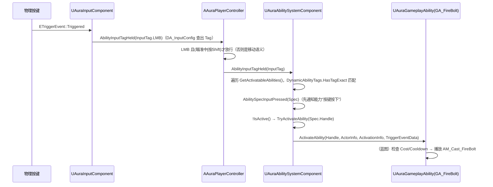
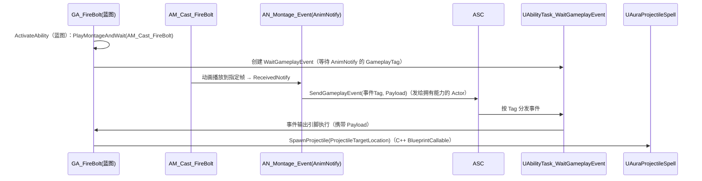

# 04 · 技能系统与网络预测（火球 FireBolt）

涉及的类与蓝图：

| 类 / 蓝图 | 文件 / 路径 | 职责 |
|---|---|---|
| `UAuraGameplayAbility` | `AbilitySystem/Abilities/AuraGameplayAbility.h` | 能力基类：只加了一个 `StartupInputTag` 配置 |
| `UAuraProjectileSpell` | `AbilitySystem/Abilities/AuraProjectileSpell.h` | 投射物技能基类：服务器生成投射物 |
| `UTargetDataUnderMouse` | `AbilitySystem/AbilityTasks/TargetDataUnderMouse.h` | AbilityTask：鼠标目标数据的本地采集与网络上传 |
| GA_FireBolt（蓝图） | `Content/.../Fire/FireBolt/GA_FireBolt.uasset` | 火球能力：Montage + WaitGameplayEvent + 调 SpawnProjectile |
| BP_FireBolt（蓝图） | 同目录 | 投射物蓝图子类 |
| AM_Cast_FireBolt（Montage） | `Content/.../Abilities/AM_Cast_FireBolt.uasset` | 施法动画 |
| AN_Montage_Event（AnimNotify） | — | 动画通知：在指定帧发 GameplayEvent |

---

## 1. 从按键到能力激活的完整链路



- **能力授予**（文档 02）：服务器 `AddCharacterAbilities` 时把能力的 `StartupInputTag` 写入 `FGameplayAbilitySpec.DynamicAbilityTags`，客户端靠 ASC 复制拿到 Spec；
- **按键释放**（`AbilityInputTagReleased`）：只调 `AbilitySpecInputReleased` 标记，**不直接取消能力**——是否因松开按键而结束由能力自己的逻辑决定（蓄力/瞬发通用）；
- **为什么用 DynamicAbilityTags 而不是能力上的标签**：Spec 是运行时副本，改键位 = 改 Spec 标签，不动能力资产。

---

## 2. UTargetDataUnderMouse —— 目标数据采集任务

**为什么需要它：** 火球需要"鼠标指向的世界位置"作为目标。GAS 规定：**客户端预测的技能不能由服务器自己猜目标**（服务器上没有本地鼠标），必须由客户端采集目标数据（TargetData）上传给服务器，服务器用同一份数据执行。

### 类设计

- 继承 `UAbilityTask`；
- 静态工厂 `CreateTargetDataUnderMouse(UGameplayAbility* OwningAbility)`（`NewAbilityTask`）——蓝图节点（`meta = (HidePin="OwningAbility", DefaultToSelf="OwningAbility")` 自动接能力）；
- `DECLARE_DYNAMIC_MULTICAST_DELEGATE_OneParam(FMouseTargetDataSignature, const FGameplayAbilityTargetDataHandle, DataHandle)` → `ValidData` 是 `BlueprintAssignable`，**蓝图里变成输出引脚**（这就是 GA_FireBolt 里 Target Data 节点接线的原理）。

### Activate() 双分支（`TargetDataUnderMouse.cpp:14`）

任务创建即被调用：

```cpp
const bool bIsLocallyControlled = Ability->GetCurrentActorInfo()->IsLocallyControlled();
if (bIsLocallyControlled) { SendMouseCursorData(); }
else
{
    // 服务器端：先绑定委托，再检查数据是否"已经先到了"
    ASC->AbilityTargetDataSetDelegate(SpecHandle, ActivationPredictionKey)
        .AddUObject(this, &UTargetDataUnderMouse::OnTargetDataReplicatedCallback);
    const bool bCalledDelegate = ASC->CallReplicatedTargetDataDelegatesIfSet(SpecHandle, ActivationPredictionKey);
    if (!bCalledDelegate) SetWaitingOnRemotePlayerData();  // 数据未到：挂起等待
}
```

**为什么"先绑定再检查"是关键：** 客户端数据可能比服务器的委托绑定先到达（网络竞态）。`CallReplicatedTargetDataDelegatesIfSet` 在"数据已缓存但委托还没绑"的场景下补广播一次，返回 false 说明数据还没到，就 `SetWaitingOnRemotePlayerData` 挂起——这是 commit `bd9f076` 记录的完整解决方案。

### SendMouseCursorData()（客户端，`TargetDataUnderMouse.cpp:35`）

```cpp
FScopedPredictionWindow ScopedPrediction(ASC);          // ① 预测窗口
PC->GetHitResultUnderCursor(ECC_Visibility, false, HitResult);   // ② 本地射线
FGameplayAbilityTargetData_SingleTargetHit* Data = new FGameplayAbilityTargetData_SingleTargetHit();
Data->HitResult = HitResult;                             // ③ 打包成 TargetData
FGameplayAbilityTargetDataHandle DataHandle; DataHandle.Add(Data);
ASC->ServerSetReplicatedTargetData(SpecHandle, GetActivationPredictionKey(),
        DataHandle, FGameplayTag(), ASC->ScopedPredictionKey);   // ④ RPC 上传（携带预测键）
if (ShouldBroadcastAbilityTaskDelegates())               // ⑤ 能力仍激活才广播
    ValidData.Broadcast(DataHandle);                     //    本地立即执行（预测）
```

### OnTargetDataReplicatedCallback()（服务器，`TargetDataUnderMouse.cpp:76`）

```cpp
ASC->ConsumeClientReplicatedTargetData(SpecHandle, GetActivationPredictionKey()); // 告知 ASC 已消费，清缓存
if (ShouldBroadcastAbilityTaskDelegates()) ValidData.Broadcast(DataHandle);
```

### 预测键（PredictionKey）机制——为什么这么写

- **`FScopedPredictionWindow`**：作用域窗口。构造时给 ASC 设置/生成当前预测键，析构时重置。窗口内发出的关键网络操作（ServerSetReplicatedTargetData 等）自动携带该键；服务器收到后拿着同一个键构造自己的窗口，把"这次预测的权威结果"标记成"对同一次预测的答复"，客户端据此对账/回滚（`TargetDataUnderMouse.cpp:37-68` 注释详解）；
- **两个键**：`AbilityOriginalPredictionKey`（能力最初激活时生成）与 `ScopedPredictionKey`（当前作用域的键）——`ServerSetReplicatedTargetData` 两个都传，服务器才能把数据挂到正确的激活实例上；
- **`ShouldBroadcastAbilityTaskDelegates`**：防止能力已结束仍广播（激活窗口已关闭），避免幽灵回调。

**为什么是最佳实现：** 这是 GAS 官方 TargetData 预测管线的标准三段式——本地采集（LocalPredicted）→ 带键上传 → 服务器补广播。服务器**不自己重新算目标**，两边对"目标"达成一致，客户端零延迟执行，服务器权威复核。

---

## 3. UAuraProjectileSpell::SpawnProjectile（`AuraProjectileSpell.cpp:18`）

```cpp
const bool bIsServer = GetAvatarActorFromActorInfo()->HasAuthority();
if (!bIsServer) return;                                 // ① 只在服务器生成（客户端靠复制看到投射物）

ICombatInterface* CI = Cast<ICombatInterface>(GetAvatarActorFromActorInfo());
const FVector SocketLocation = CI->GetCombatSocketLocation();  // ② 武器尖 socket 世界坐标
FRotator Rotation = (ProjectileTargetLocation - SocketLocation).Rotation();
Rotation.Pitch = 0.0f;                                   // ③ 俯视游戏：投射物水平飞，压平俯仰

AAuraProjectile* Projectile = GetWorld()->SpawnActorDeferred<AAuraProjectile>(
    ProjectileClass, SpawnTransform,
    GetOwningActorFromActorInfo(),                      // Owner = 能力拥有者
    Cast<APawn>(GetAvatarActorFromActorInfo()),         // Instigator = 角色 Pawn
    ESpawnActorCollisionHandlingMethod::AlwaysSpawn);   // ④ 延迟生成

const UAbilitySystemComponent* SourceASC = UAbilitySystemBlueprintLibrary::GetAbilitySystemComponent(GetAvatarActorFromActorInfo());
const FGameplayEffectSpecHandle SpecHandle = SourceASC->MakeOutgoingSpec(
    DamageEffectClass, GetAbilityLevel(), SourceASC->MakeEffectContext());
Projectile->DamageEffectSpecHandle = SpecHandle;        // ⑤ 生成完成前注入伤害 GE Spec

Projectile->FinishSpawning(SpawnTransform);             // ⑥ 完成生成（此时才跑构造/BeginPlay）
```

**为什么用 SpawnActorDeferred + FinishSpawning 而不是直接 SpawnActor：**
- 生成后有"初始化数据"要注入（伤害 GE 的 Spec），直接 SpawnActor 会先跑完构造和 BeginPlay，之后赋值会有竞态/一帧延迟；
- Deferred 流程：SpawnActorDeferred 只分配对象（构造跑完，BeginPlay 不跑）→ 外部设置属性 → FinishSpawning 触发 BeginPlay 及组件初始化，**数据先于生命周期就位**；
- Owner/Instigator 正确设置 → 网络所有权（服务器生成、复制到客户端）和伤害溯源（击杀统计）都成立。

**为什么伤害 GE 的 Spec 在能力侧提前做好：** Spec 在服务器上制作（源 = 施法者 ASC，等级 = 能力等级），投射物命中时直接 `ApplyGameplayEffectSpecToSelf`，源/等级/上下文都是权威值；客户端命中的投射物不做任何伤害计算。

### 蓝图 GA_FireBolt 的调用流



链路（commit `97fcd28` 总结）：**AnimNotify（发信号）→ ASC（做分发）→ UAbilityTask_WaitGameplayEvent（接信号）→ 唤醒 GameplayAbility（继续执行）**。这样"动画播到出手帧才生成火球"完全由 Montage 的动画通知驱动，美术可自由调整出手时机，程序零改动。

另外：GA 激活时调用 `ICombatInterface::UpdateFacingTarget`（BlueprintImplementableEvent）→ 蓝图里用 **MotionWarping** 让角色施法前转向目标（commit `7f247b3`）。
