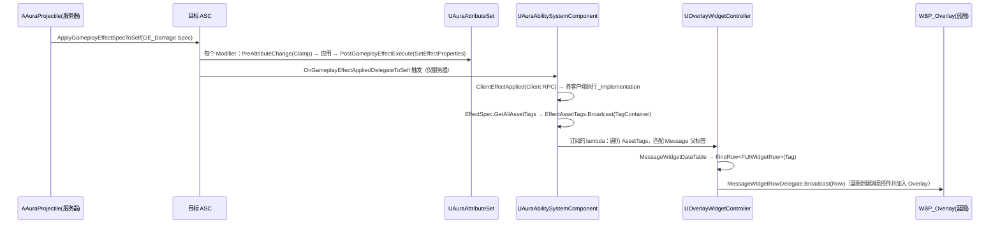

# 05 · 投射物与效果应用（伤害链路 / 药水 / 消息提示）

涉及的类与蓝图：

| 类 / 蓝图 | 文件 / 路径 | 职责 |
|---|---|---|
| `AAuraProjectile` | `Actor/AuraProjectile.h` | 火球投射物：碰撞、特效音效、命中应用伤害 GE |
| `AAuraEffectActor` | `Actor/AuraEffectActor.h` | 药水/水晶/区域效果基类：三类 GE 的策略化应用与移除 |
| `GE_Damage`（蓝图） | `Content/.../GameplayEffects/GE_Damage.uasset` | 伤害效果（属性捕获 Armor 等做减免，蓝图配置） |
| BP_Potion / BP_Crystal / BP_Area（蓝图） | `Content/Blueprints/Actor/` | EffectActor 子类配置 |
| BP_ManaPotion 等 | 同上 | 具体药水 |

---

## 1. AAuraProjectile（火球投射物）

### 构造（`AuraProjectile.cpp:16`）

```cpp
PrimaryActorTick.bCanEverTick = false;   // 移动交给 ProjectileMovement 组件，不 Tick
bReplicates = true;                      // 服务器生成、客户端复制

Sphere = CreateDefaultSubobject<USphereComponent>("Sphere");   // 根组件
Sphere->SetCollisionObjectType(ECC_Projectile);                // 自定义通道（Aura.h → GameTraceChannel1）
Sphere->SetCollisionEnabled(ECollisionEnabled::QueryOnly);     // 只查询不阻挡
Sphere->SetCollisionResponseToAllChannels(ECR_Ignore);
Sphere->SetCollisionResponseToChannel(ECC_WorldDynamic, ECR_Overlap);
Sphere->SetCollisionResponseToChannel(ECC_WorldStatic, ECR_Overlap);
Sphere->SetCollisionResponseToChannel(ECC_Pawn, ECR_Overlap);  // 与三类对象重叠

ProjectileMovement->InitialSpeed = 500.f;
ProjectileMovement->ProjectileGravityScale = 0.f;              // 俯视游戏无重力
```

角色 Mesh 侧对应配置（`AuraCharacterBase.cpp:20`）：`SetCollisionResponseToChannel(ECC_Projectile, ECR_Overlap)` + `SetGenerateOverlapEvents(true)` —— 胶囊体不挡、网格体接收重叠。

### BeginPlay

`SetLifeSpan(15.f)`（超时自毁兜底）→ 绑定 `Sphere->OnComponentBeginOverlap` → `SpawnSoundAttached(LoopingSound)` 循环音效。

### 命中处理 OnSphereOverlap（`AuraProjectile.cpp:46`）—— 表现与逻辑分离

```cpp
// ① 表现层：所有端都播（音效/特效本地播放零延迟）
PlaySoundAtLocation(ImpactSound); SpawnSystemAtLocation(ImpactEffect);
LoopingSoundComponent->Stop(); LoopingSoundComponent->DestroyComponent();

if (HasAuthority())
{
    // ② 逻辑层：只有服务器权威执行伤害
    if (UAbilitySystemComponent* TargetASC = GetAbilitySystemComponent(OtherActor))
        TargetASC->ApplyGameplayEffectSpecToSelf(*DamageEffectSpecHandle.Data.Get());  // 应用能力侧注入的 GE Spec
    Destroy();      // 服务器销毁 → 复制到客户端销毁
}
else { bHit = true; }   // ③ 客户端标记"本地已命中"
```

### Destroyed() 补播（`AuraProjectile.cpp:78`）

```cpp
if (!bHit && !HasAuthority()) { /* 补播 ImpactSound/ImpactEffect */ }
```

**为什么需要 bHit：** 客户端没触发重叠但被服务器销毁（如生命周期到期、服务器端先命中）时，客户端也要播一次命中特效；已播过（bHit=true）就跳过，防止双播。注释原文："为了防止服务器端销毁时客户端还没触发重叠，所以设置 bool 值在销毁时判断是否再播放一次音效等效果"。

**为什么是最佳实现：**
- 伤害只在服务器做 → 无客户端作弊、数值单一权威；表现本地播 → 手感零延迟；
- 伤害数据（GE Spec）由能力在生成前注入（见文档 04），投射物本身不懂伤害公式，复用性高（同套投射物换 GE 就变技能）；
- Tick 关闭 + ProjectileMovement 组件负责运动 → 省掉逐帧开销。

---

## 2. AAuraEffectActor（药水 / 水晶 / 区域）

### 策略枚举（数据驱动核心）

```cpp
UENUM(BlueprintType) enum class EEffectApplicationPolicy { ApplyOnOverlay, ApplyOnEndOverlay, DoNotApply };
UENUM(BlueprintType) enum class EEffectRemovalPolicy   { RemoveOnOverlay,  DoNotRemove };
```

三类 GE 各配一个 ApplicationPolicy（瞬时药水 = Instant + ApplyOnOverlay；Buff 药水 = Duration/Infinite + ApplyOnOverlay；离开区域移除 = Infinite + RemoveOnOverlay），全部在蓝图资产上勾选。

### ApplyEffectToTarget（`AuraEffectActor.cpp:23`）

```cpp
UAbilitySystemComponent* TargetASC = UAbilitySystemBlueprintLibrary::GetAbilitySystemComponent(TargetActor);
FGameplayEffectContextHandle Ctx = TargetASC->MakeEffectContext();
Ctx.AddSourceObject(TargetActor);                                     // 溯源：谁给的效果
FGameplayEffectSpecHandle Spec = TargetASC->MakeOutgoingSpec(GE, ActorLevel, Ctx);  // ActorLevel 控制 GE 强度
FActiveGameplayEffectHandle Handle = TargetASC->ApplyGameplayEffectSpecToSelf(*Spec.Data.Get());

// 读 GE 的 CDO 判断持续时间策略（CDO 只读，不能改属性）
const bool bIsInfinite = Spec.Data.Get()->Def.Get()->DurationPolicy == EGameplayEffectDurationType::Infinite;
if (bIsInfinite && InfiniteEffectRemovalPolicy == RemoveOnOverlay)
    ActiveEffectHandles.Add(Handle, TargetASC);   // 保存句柄，离开时才删得掉
```

### OnOverlay / OnEndOverlay（BlueprintCallable，由蓝图 Overlap 事件调用）

- 进入重叠：按各自策略应用三类 GE；
- 离开重叠：按策略移除 Infinite GE：

```cpp
for (TPair<FActiveGameplayEffectHandle, UAbilitySystemComponent*> Pair : ActiveEffectHandles)
{
    TargetASC->RemoveActiveGameplayEffect(Pair.Key, 1);   // 栈数 -1（支持叠加计数）
    HandlesToRemove.Add(Pair.Key);                        // 迭代中不直接删 map 元素
}
for (auto& H : HandlesToRemove) ActiveEffectHandles.FindAndRemoveChecked(H);
ActiveEffectHandles.Empty();
```

**为什么用 HandlesToRemove 两段式删除：** 遍历 TMap 时删除元素会使迭代器失效；先收集再删是 C++ 容器遍历安全的标准手法（代码注释写明）。

**为什么是最佳实现：** 一套 C++ 代码 + 枚举配置覆盖"瞬时/持续/永久、进出触发"全部药水形态；Infinite GE 没有生命周期终点，**必须**保存 `FActiveGameplayEffectHandle` 才能主动移除——这是 GAS 的硬性要求。

---

## 3. 伤害 → 消息提示完整链路（跨系统调用链）



- `GE_Damage`（蓝图）：Modifier 伤害公式（基于捕获 Armor/ArmorPenetration 等）+ **AssetTags 里挂 `Message.*` 标签**——标签是 GE 自带的"元数据"，随 `GetAllAssetTags` 免费传递，UI 据此查表拿文案/图标；
- **为什么消息用标签而不是事件：** GE 与 UI 零耦合——加一种新伤害只改 GE 标签 + DataTable 加一行，任何代码不用动。

**注意（正在排查的问题）：** 服务器端 `SpawnProjectile` 目前存在收到 (0,0,0) 目标点的情况（目标数据链路问题，见 memory 中的排查记录），排查方向是 BP_FireBolt / GA_FireBolt 蓝图的引脚连线。
