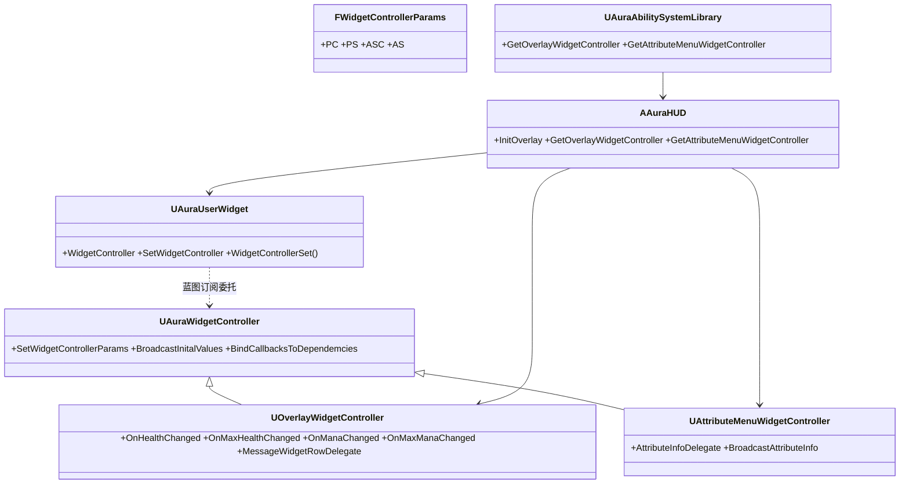
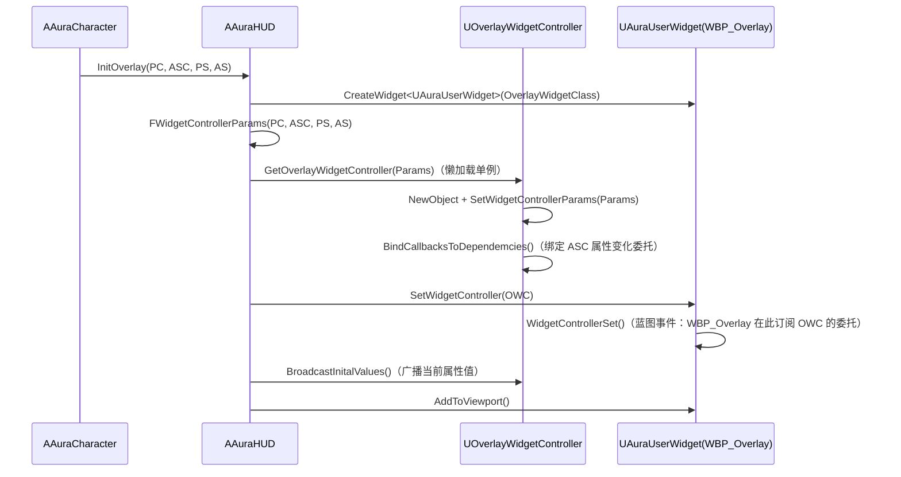

# 06 · UI 的 MVC 架构

涉及的类与蓝图：

| 类 / 蓝图 | 文件 / 路径 | 职责 |
|---|---|---|
| `FWidgetControllerParams`（结构体） | `UI/WidgetController/AuraWidgetController.h` | 打包 {PC, PS, ASC, AS} 四个指针，控制器的"输入参数" |
| `UAuraWidgetController` | 同上 | 控制器基类：持有四个指针、虚函数广播/绑定 |
| `UOverlayWidgetController` | `UI/WidgetController/OverlayWidgetController.h` | 主 HUD：血量法力委托 + 消息行委托 |
| `UAttributeMenuWidgetController` | `UI/WidgetController/AttributeMenuWidgetController.h` | 属性菜单：遍历 TagsToAttributes 批量广播 |
| `AAuraHUD` | `UI/HUD/AuraHUD.h` | 组装工厂：创建 Widget + 控制器并接线 |
| `UAuraUserWidget` | `UI/Widget/AuraUserWidget.h` | 控件基类：持有一个 WidgetController |
| `UAuraAbilitySystemLibrary` | `AbilitySystem/AuraAbilitySystemLibrary.h` | 蓝图函数库：任意蓝图获取 WidgetController |
| WBP_Overlay / WBP_Globe_ProgressBar / WBP_ProgressBar / WBP_EnemyHealthBar | `Content/Blueprints/UI/` | 蓝图控件（纯订阅者） |

**核心数据流：`AAuraHUD` → `UOverlayWidgetController` → `UAuraUserWidget`（蓝图）**

---

## 1. 类结构与依赖方向



**依赖规则：Widget 不认识 GAS；Controller 不认识 Widget。** 两边通过 `BlueprintAssignable` 委托对接，蓝图 WBP 是唯一知道两边的人（订阅者）。

---

## 2. InitOverlay 的装配顺序（`AuraHUD.cpp:34`）



**顺序为什么不能换（关键）：**
1. **先 BindCallbacks 再 Broadcast**：`GetOverlayWidgetController` 内部先绑定 ASC 的回调、后由 HUD 调 `BroadcastInitalValues` 广播初始值——保证初始值和后续变化走同一条数据线，不漏事件；
2. **先 SetWidgetController 再 Broadcast**：WBP 必须已订阅（`WidgetControllerSet` 里绑定委托）后才广播，否则初始值没人接；
3. **懒加载单例**：`GetXxxWidgetController` 只在 nullptr 时 NewObject，重复调用返回同一实例——多个 Widget 共用控制器时委托只绑一次。

---

## 3. UAuraWidgetController 基类（`AuraWidgetController.h`）

- `SetWidgetControllerParams`：把参数结构体拆进四个成员（`PlayerController/PlayerState/AbilitySystemComponent/AttributeSet`）；
- `BroadcastInitalValues()` / `BindCallbacksToDependemcies()`：**虚函数空实现**——子类覆写，基类定义统一的两阶段协议。

**为什么把 {PC, PS, ASC, AS} 打包成 `FWidgetControllerParams` 结构体：** 控制器可能从多种入口被创建（HUD 初始化 / 蓝图函数库），四个指针打包成一个参数，函数签名稳定，新增上下文时改结构体不改函数签名。

---

## 4. UOverlayWidgetController（主 HUD 控制器）

### 属性委托（4 个 BlueprintAssignable）

```cpp
DECLARE_DYNAMIC_MULTICAST_DELEGATE_OneParam(FOnAttributeChangedSignature, float, NewValue);
UPROPERTY(BlueprintAssignable) FOnAttributeChangedSignature OnHealthChanged; // + MaxHealth/Mana/MaxMana
```

### BindCallbacksToDependemcies（`OverlayWidgetController.cpp:21`）

对每个属性：

```cpp
AbilitySystemComponent->GetGameplayAttributeValueChangeDelegate(
    UAuraAttributeSet::GetHealthAttribute()).AddLambda(
        [this](const FOnAttributeChangeData& Data) { OnHealthChanged.Broadcast(Data.NewValue); });
```

`GetGameplayAttributeValueChangeDelegate` 是 ASC 内置的"属性值变化"多播委托——**GAS 对 UI 的通知入口**。用 lambda 把 `FOnAttributeChangeData` 翻译成只含 float 的蓝图委托，WBP 里接 `OnHealthChanged` 更新血球。

### 消息行（拾取提示）

```cpp
Cast<UAuraAbilitySystemComponent>(AbilitySystemComponent)->EffectAssetTags.AddLambda(
    [this](const FGameplayTagContainer& AssetTags)
    {
        for (const FGameplayTag& Tag : AssetTags)
            if (Tag.MatchesTag(FGameplayTag::RequestGameplayTag(FName("Message"))))
            {
                FUIWidgetRow* Row = GetDataTableRowByTag<FUIWidgetRow>(MessageWidgetDataTable, Tag);
                MessageWidgetRowDelegate.Broadcast(*Row);
            }
    });
```

- `FUIWidgetRow : FTableRowBase`：`{MessageTag, Message(FText), MessageWidget(TSubclassOf<UAuraUserWidget>), Image}`；
- `GetDataTableRowByTag<T>`：`DataTable->FindRow<T>(Tag.GetTagName(), TEXT(""))`；
- 数据源是 `DT_MessageWidgetData`（DataTable），**文案/图标/控件类都是策划可改的数据**。

### BroadcastInitalValues

`CastChecked<UAuraAttributeSet>(AttributeSet)` 读当前值，把四个委托各广播一次。

---

## 5. UAttributeMenuWidgetController（属性菜单）

```cpp
// BroadcastInitalValues
for (TPair<FGameplayTag, FGameplayAttribute(*)()>& Pair : AS->TagsToAttributes)
    BroadcastAttributeInfo(Pair.Key, Pair.Value());          // Pair.Value() = 调 Getter 得 FGameplayAttribute

// BroadcastAttributeInfo
FAuraAttributeInfo Info = AttributeInfo->FindAttributeInfoForTag(Tag);  // 名称/描述来自 DataAsset
Info.AttributeValue = Attribute.GetNumericValue(AttributeSet);         // 数值来自 AttributeSet
AttributeInfoDelegate.Broadcast(Info);

// BindCallbacksToDependemcies
for (TPair<...>& Pair : AS->TagsToAttributes)
    ASC->GetGameplayAttributeValueChangeDelegate(Pair.Value()).AddLambda(
        [this, Pair](const FOnAttributeChangeData& Data) { BroadcastAttributeInfo(Pair.Key, Pair.Value()); });
```

**为什么是最佳实现：** `TagsToAttributes`（文档 01 的 Tag→Getter 函数指针 map）在这里兑现价值——**14 个属性两段循环搞定，新增属性一行注册即自动出现在菜单**（commit `85ec66b`/`83b7a49` 记录了从"每属性一行 if"到"委托 BindStatic"再到"静态函数指针 map"的演进）。

---

## 6. UAuraAbilitySystemLibrary（蓝图函数库）

```cpp
// GetOverlayWidgetController(WorldContextObject)：蓝图里一键拿控制器
PC = UGameplayStatics::GetPlayerController(WorldContextObject, 0);
AAuraHUD* HUD = Cast<AAuraHUD>(PC->GetHUD());
AAuraPlayerState* PS = PC->GetPlayerState<AAuraPlayerState>();
FWidgetControllerParams Params(PC, PS->GetASC(), PS, PS->GetAttributeSet());
return HUD->GetOverlayWidgetController(Params);
```

**为什么需要它：** WBP 不是由 HUD 创建的场景（例如属性菜单面板 WBP_AttributeMenu 自己挂在 Overlay 里）无法拿到控制器，函数库提供"从任意 WorldContext 取控制器"的入口。HUD 内部是懒加载，函数库重复调用也安全。

---

## 7. 敌人血条的特殊接线

`WBP_EnemyHealthBar` 不走 WidgetController 子类——`AAuraEnemy::BeginPlay` 里 `SetWidgetController(this)`，**敌人自己充当控制器**（`OnHealthChanged/OnMaxHealthChanged` 是 BlueprintAssignable，直接绑）。说明这套架构的"控制器"只需要满足"有可订阅委托"这一契约，不强制继承某个基类。
