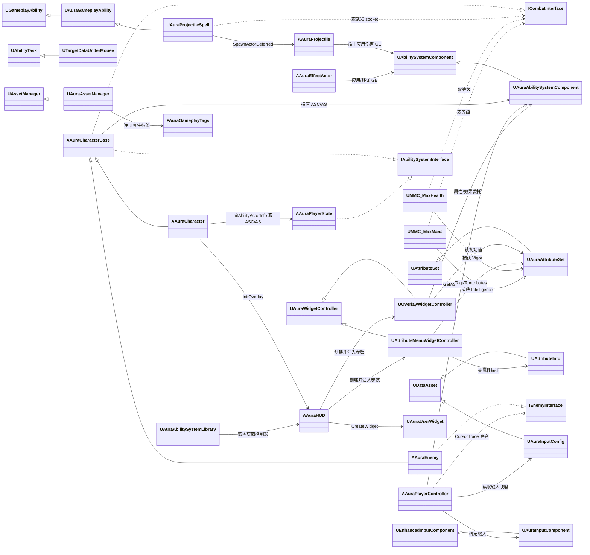

# Aura 项目架构总结（按模块分文档）

> 基于本仓库自写的 C++ 代码与蓝图资产整理。每个子文档包含：类职责、方法调用关系与调用顺序、关键方法功能、"为什么是最佳实现"。

## 模块划分与文档索引

| 文档 | 内容 |
|---|---|
| [01-GAS核心与属性系统](01-GAS核心与属性系统.md) | GameplayTags 原生标签单例、AssetManager 初始化、自定义 ASC、AttributeSet（17 属性 + 复制）、MMC 计算器、属性数据资产 |
| [02-角色体系与初始化流程](02-角色体系与初始化流程.md) | AuraCharacterBase / AuraCharacter / AuraEnemy / AuraPlayerState、两个接口、PossessedBy 与 OnRep_PlayerState 双入口初始化时序 |
| [03-输入系统与移动控制](03-输入系统与移动控制.md) | Enhanced Input 数据驱动绑定、CursorTrace 高亮状态机、点击移动 / 长按移动、Spline 自动寻路、Shift 炮台 |
| [04-技能系统与网络预测](04-技能系统与网络预测.md) | 输入标签→能力激活链路、火球 GA、TargetDataUnderMouse AbilityTask、预测键与服务器目标数据复制 |
| [05-投射物与效果应用](05-投射物与效果应用.md) | 投射物碰撞与伤害、药水/水晶 EffectActor、伤害→消息提示完整链路 |
| [06-UI-MVC架构](06-UI-MVC架构.md) | HUD / WidgetController / UserWidget 三层解耦、属性菜单、蓝图函数库 |
| [07-简历知识点汇总](07-简历知识点汇总.md) | 可写进简历的技术点、简历示例、面试可能追问点 |

## 类依赖总图

## 架构层面的设计原则

1. **UI 只依赖 WidgetController，不直接依赖 GAS** —— 控件层完全在蓝图中订阅 `BlueprintAssignable` 委托。
2. **数据驱动** —— 输入映射（`UAuraInputConfig`）、属性说明（`UAttributeInfo`）、消息文案（DataTable）、效果策略（枚举）都在蓝图/资产里配置，C++ 只提供机制。
3. **服务器权威 + 客户端表现** —— 伤害、GE、生成投射物只在服务器执行；特效/音效/UI 在本地播放。
4. **面向接口解耦** —— 能力通过 `ICombatInterface` 取发射点，不依赖具体角色类；控制器通过 `IEnemyInterface` 高亮，不依赖具体敌人类。
5. **新增属性零 UI 改动** —— `TagsToAttributes`（Tag→Getter 函数指针 map）让属性菜单自动扩列。
